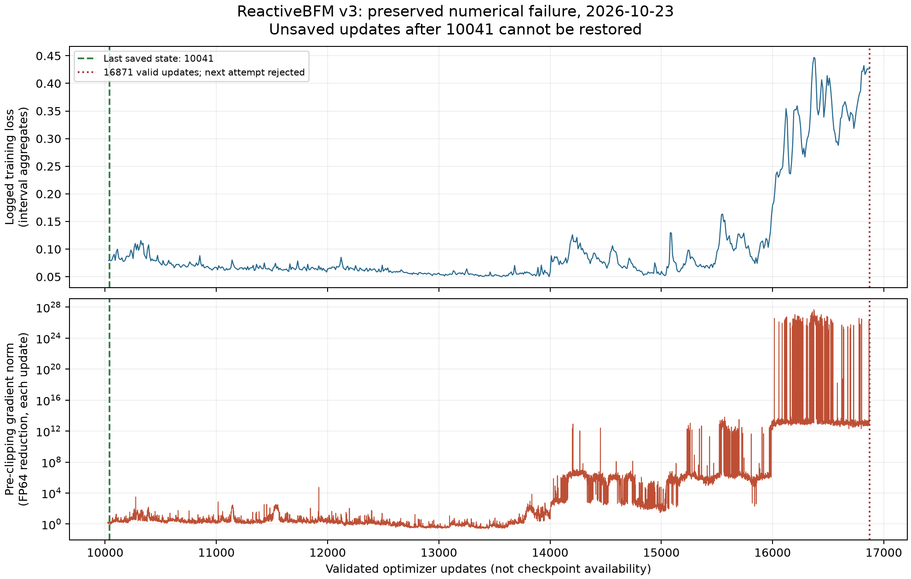

# 2026-10-23 后续检查：ReactiveBFM 数值异常与恢复验证

本报告对应北京时间 06:23 发起的检查。**两篇论文尚未完成论文规模复现。ReactiveBFM v3 已自行异常退出；不能继续沿用先前“正在正常训练”的状态。** 本轮保存故障证据、定位数值不稳定，并验证新的恢复候选方案。PhyGile 配对数据和此前实验原样保留。

本报告后的复制连接重试与最新回执位置，见[备份补充记录](backup_followup_20261023.md)。Release 内同名附件为首次发布快照，后续变化单独记录。

## 已确认的故障与可恢复范围

- 停止时间：2026-10-23 05:47:17（北京时间，日志 UTC 为 10-22 21:47:17）。两个训练进程均由数值保护停止，本次检查没有中断它们。
- 已完成并通过模型、优化器和 EMA 有限值检查的更新数：**16,871**。下一次尝试出现非有限梯度，在梯度裁剪及参数更新前被拒绝，停止原因为 `NONFINITE_NORM_BEFORE_CLIPPING`。
- 最新落盘且通过 SHA256 校验的恢复状态：**10,041 次更新**。模型、EMA 和 AdamW 状态都在。不能从日志重建其后 **6,830 次未落盘更新**。
- 保存了完整的双 rank 健康日志、训练指标、终止日志、配置、检查点就绪清单和当时兼容代码，未删除数据集、检查点或旧记录。

上图的损失是训练日志中的区间统计，不是生成质量或动作成功率。梯度范数来自每次更新前的 FP64 归约，最大有限值约 `4.7824×10^27`；约 14k 后持续恶化。梯度裁剪到 1 并未阻止这种内部数值异常的发展。

## 可重复的数值对照

使用同一个保存模型、同一批真实训练数据、相同随机种子和三个训练片段，未构造优化器、未更新检查点。小批量为 8，实际单卡训练批量为 512。最后重新检查输入文件 SHA256，确认未变化。以下数值来自最后一次完整对照（v5），不是不同模型的性能比较。

| 单卡批量 512，启用激活重算 | 损失 | 全模型梯度范数 | 前向/反向耗时 |
|---|---:|---:|---:|
| 原 FP32 默认注意力 | 0.07660169 | 1.440801 | 7.40 秒 |
| 强制 FP32 math 注意力 | 0.07660001 | 1.570239 | 7.12 秒 |
| 注意力 FP64、输出及其余模型 FP32 | 0.07660180 | 1.328727 | 17.19 秒 |

耗时包含本诊断的记录工作，不是完整训练吞吐。三者本次均得到有限梯度；损失相近不代表梯度一致。

对首层注意力实际输入 Q/K/V 与同一个上游梯度进行独立重算，并以 FP64 math 结果作为数值参考：

| 首层自注意力梯度相对 L2 误差 | Q | K | V |
|---|---:|---:|---:|
| 默认 FP32 对 FP64 参考 | 6.9388 | 0.7826 | 0.6093 |
| math FP32 对 FP64 参考 | 6.7149 | 9.9905 | 0.0100 |

该次自注意力的 Q 最大绝对值约 5452.23，K 约 2509.47；相同检查中的交叉注意力误差仅约 `10^-6`。已确认 dropout 为 0，TF32 关闭；克隆输入后结果保持一致。仅更换另一种 FP32 注意力实现不足以消除本例的精度问题。

**解释边界：**这是保存检查点上可重复的注意力数值敏感性证据，不能单独证明 16,872 次尝试的故障完全由某一个 CUDA 内核造成。终止前的完整内存状态未保存，无法精确重放那次失败。最初检查中的激活重算没有显示明确错误。五次诊断的源码、命令、原始输出和结果均保留，包括中间尝试。

## 恢复候选与验证状态

独立兼容层只将官方 DiT 的自注意力、交叉注意力 SDPA 运算提升为 FP64，然后恢复 FP32 输出。参数、AdamW、网络结构、训练目标、学习率 `1e-4`、全局 batch 1024、400k teacher forcing 和 1M 目标均保留。不引入 Q/K 归一化或 logit 裁剪。该层不是作者发布代码，计算精度与原方案的差异明确保留。

使用既有 Python 3.10 / Torch 2.5.1+cu121 环境；双 A6000，每卡 batch 512、每进程四线程、65% PyTorch 分配上限。原训练与故障目录不改写。新配置将后续保存间隔由 10k 改成 1k，以减少潜在未保存进度；这是实验记录策略变更。

独立读者按文档原样执行一次，双卡恢复探测**通过**：两个 rank 均为 `PROBE_COMPLETED`，更新计数 10,041→10,061，各完成20次优化器更新、跳过0次、EMA校验通过，supervisor退出码0，约359秒。探测不保存新检查点，不能把它的计数当作新的可恢复状态；原始日志及独立见证保存在结果目录。

随后从原10,041检查点启动单独的长期候选续训。首次确认两卡均为 `TRAINING`、10,043次更新、跳过0次、梯度范数有限。两个训练进程仍在原65%分配限制内；此时显卡总占用（包含其他进程）约35,604/32,300 MiB。**这只确认恢复已经开始，长期稳定性尚未证实。**

新进程输出：`/data/code/ouyanghao/oyh/paper-faithful-reproduction-20261022/training_fp64_sdpa_v4`。只复制、不清理服务器的单次备份已启动，等待首次新检查点10,061，之后将校验模型/优化器对、保存本地并上传同一GitHub Release。首次状态记录时仍在等待，不能声称新权重已经上传；其状态以本地 `recovery_v4_checkpoint_10061/receipt.json` 为准。没有重复启动旧备份程序。

## 磁盘、资产与后续工作

检查时 `/data` 可用约 **5.21 GiB**，系统盘可用约 **1.71 GiB**。一个模型、EMA、AdamW 检查点对约 **1.59 GiB**。训练保存程序要求写入后保留至少 2 GiB，空间不足会等待，不删除旧文件。旧备份程序已随 v3 故障停止，本次不会重启其清理逻辑或创建重复备份任务。

PhyGile 仍只有经过时基筛选的 40 条配对序列（34 train、6 test、0 validation）；另外 26 条及其原始动作保留。物理过滤、真实课程难度标签、论文规模网络训练和生成—执行闭环仍未完成。作者未公开的完整生成器与私有数据不能由小样本或随机初始化替代。本轮没有新增 PhyGile 训练结果。

本轮没有新的物理闭环评价，因此不制作或标注“新模型结果视频”。既有实际视频仍可在[报告与视频发布页](https://github.com/Pendragon08/conditional-human-motion-generation/releases/tag/paper-reproduction-progress-20261023)查看：ReactiveBFM 使用 10,041 次更新检查点，10 秒仿真、20 次新规划被采用、37/500 帧超过近似失败阈值，仍判失败；PhyGile 四动作两种仿真各 1/4 完整执行。后续新检查点须经过校验和真实异步仿真后再增加视频及评价。

## 可追溯文件

- 完整故障包：`reactivebfm_v3_failure_20261023.tar.gz`，1,132,137 字节，SHA256 `f0caaef59fd19c029a5ff0d26a66b9ff03af40fffe43475068e718c6a5adfd1d`。
- 五次诊断包：`numerical_diagnostics_v1_v5.tar.gz`，7,684 字节，SHA256 `3f0dcff2ce00da8a952c64fa16e940cfa73d6d2de36e75c12fc643b385f59252`。
- [数值对照与终止记录](../results/heartbeat_20261023_0623/)、[恢复代码和配置](../recovery_v4/)、[独立文档执行入口](../recovery_v4/ENVIRONMENT.md)。
- 本地目录：`D:/具身智能/PhyGile与ReactiveBFM_论文对齐复现_20261022`。

公开包只包含代码、统计及实验记录，不含受限制的 AMASS/SMPL 原始动作或人体模型。
