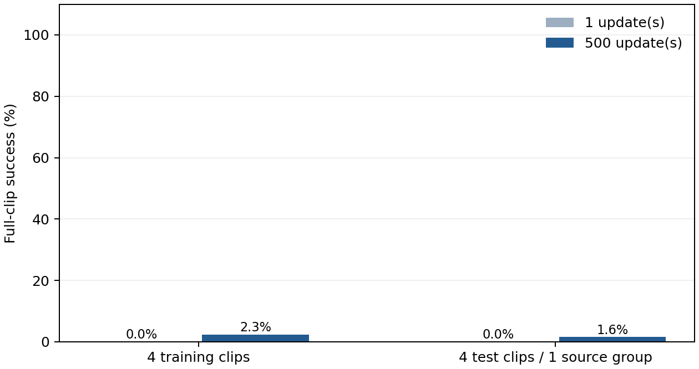
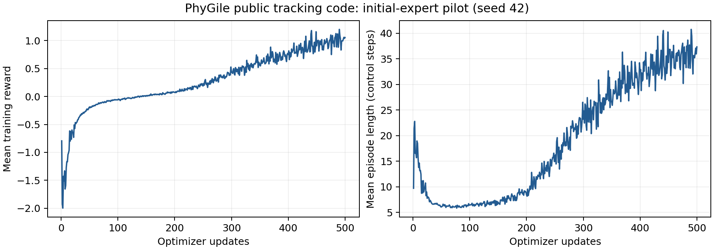

# PhyGile 复现实验报告

日期：2026-10-17。对象：**公开 GMT 跟踪模块的仿真运行与缩小规模验证**。完整论文方法的复现状态：**未完成，缺少公开生成组件及对应材料**。

## 1. 直接结论

本次已在原双 RTX A6000 服务器上跑通官方跟踪代码，完成一次独立冒烟验证、500 次 PPO 更新，以及 16 组检查点—片段组合评估。所有结果来自实际 Isaac Lab 仿真；没有真机实验。

**不能把这份模型标成“完整 PhyGile 复现模型”或把这些数字填入论文正式对比主表。** 当前只有起始专家被激活，训练数据仅约 1 分钟，测试只有一个独立来源组。最终检查点在本协议的测试片段上完成 2/128 个完整回合。

可用于后续开发的是已验证的跟踪训练工程、失败判定、输入检查和结果记录流程。完整文本到机器人动作比较仍需补齐下述材料。

## 2. 官方材料核查

官方网页仅给出 `Code (Tracking)`，链接到 `Baojch/phygile_tracking`。固定源码提交 `d48621620f522f5c901ef378d57db8df92d2888d`，提交日期 2026-04-25。论文阅读版本为 arXiv:2603.19305v3（2026-08-30）。不同时间的公开材料可能存在差异，不能默认代码与论文所有设置一致。

|组件|核查与复现状态|
|---|---|
|GMT 跟踪器、MoE、PPO 和 Phase A/B 配置|代码存在；本次执行其起始跟踪阶段|
|262D robot-native 扩散生成器、TP-MoE 文本条件部分|在所查仓库中未找到完整实现或权重入口|
|physics-prefix 续写、闭环适配训练|论文有描述，所查仓库中未找到完整运行入口|
|作者 GMT 权重|检查时 GitHub releases 为空，README 未提供可用检查点下载|
|论文完整数据与难度划分|未得到可直接运行的匹配数据包；已有 CSV 不等同于完整配套数据|
|G1 真机|按用户要求不开展|

这里的“未找到”限定于核查日期的官方项目页、固定版本仓库和 releases，不表示作者没有内部材料。

## 3. 实际环境与适配

- Isaac Sim 4.5.0，Isaac Lab 2.1.0，Python 3.10.15。
- PyTorch 2.5.1+cu118，RSL-RL 2.3.1，NumPy 1.26.0，Gymnasium 0.29.1。
- GPU 0：RTX A6000 48 GB；使用 4 个 CPU 计算线程。没有终止服务器原有任务。
- 使用独立目录、缓存和跟踪包入口，复用现有仿真安装和 G1 资产。
- 新增离线地面显示材质、可写 USD 缓存路径；未改物理接触参数。
- 训练入口新增关节顺序、刚体顺序、50 Hz 时序检查。全部 20 个训练文件通过。
- 独立审查发现官方加载器未应用 YAML 的 `rewards` 段：global anchor position 的实际奖励权重为 0.5/std 0.25，而非文件声明的 0.8/0.2。本实验全程保持该实际行为，已保存有效环境参数与日志；不能声称 YAML 奖励覆盖生效。
- 按官方示例采用 `Tracking-Flat-G1-Wo-State-Estimation-v0`。早先的状态观测试运行被替换，保留记录但不计入最终结果。

环境先通过种子固定的 CUDA 前向/反向运算，再由独立代理按文档原样执行一次真实 PPO 更新。单次冒烟为 32 环境 × 24 步 = 768 个转移，退出码 0，检查点落盘。图形/无显示缓存诊断未阻止该次仿真；精确 Isaac Lab 版本另外从安装目录 VERSION 文件核对。

## 4. 数据和训练协议

参考来自用户服务器已有的 KungfuAthleteBot 数据处理链：公开视频动作重建 → GMR 重定向 → G1 前向运动学参考。它是数据集提供动作派生的运动学目标，不是本次策略生成的“真值”，也不是测得的机器人执行轨迹。

训练 20 个片段、7 个来源组，共 59.60 秒；测试 4 个片段、1 个来源组，共 11.92 秒。每片段 149 帧、50 Hz，即 2.98 秒。训练和测试来源组无交集。输入文件与转换前文件均有哈希和来源链，保存在 `data_inventory.json`、`data_provenance.json`。

|设置|本次实际值|
|---|---|
|训练随机种子|42（仅 1 个训练种子）|
|并行环境|1024|
|每次更新采样步数|24|
|更新次数|500|
|累计环境转移|12,288,000|
|训练耗时|22.12 分钟（含启动及保存）|
|策略|官方 MoEActorCritic / MoEPPO，12 个已分配专家，实际激活 1 个|
|专家网络|公开配置 `[512,256]`；与论文附录 `[2048,1024,512]` 不同|
|初始化|随机初始化；没有使用作者预训练权重|
|课程、冻结、淘汰|关闭；没有为这些片段伪造作者难度标签|
|后训练扩展 / physics-prefix|未运行|

关闭课程后，官方代码仍保持初始激活专家数 1。尽管对象名是 MoE，**此实验不能验证多专家分工或扩展机制**。论文约 45 小时训练数据、8192 环境、200,000 次更新等设置与本实验差距很大。

## 5. 评估方法

比较 `model_0.pt` 与 `model_499.pt`，分别代表 **1 次与 500 次 PPO 更新**，前者不是纯随机未训练策略。预先选定训练片段 000/008/010/014，并评估全部 4 个测试片段；每个组合包含 32 个并行首回合，评估种子 2026。这 32 回合不等于 32 个独立训练种子。

每个回合从第 0 帧开始，保留训练失败终止阈值、初始扰动和物理随机化，关闭间隔推力与观测噪声。每个控制间隔的物理步完成后、自动重置前，记录当前命令帧及实际关节/刚体状态。没有在已经重置后的姿态上统计末次误差。

- 完整片段成功：连续执行 149 个控制间隔，且没有触发官方失败终止。
- MPJPE：14 个跟踪刚体的世界位置误差范数均值，单位米。
- MPJAE：29 个关节角度绝对误差均值，单位弧度。
- MPJVE：29 个关节角速度绝对误差均值，单位弧度/秒。
- 平均持续时间：首次回合从起始帧至失败或片段结束的实际采样步数 / 50。

**误差仅统计至首次终止。更早失败的模型可能得到更小的平均误差，因此必须同时查看成功率和持续时间。** 汇总表的 MPJPE 按片段等权平均；逐片段指标按其有效环境—时间样本平均。没有按模型自身最大值归一化。

这里的世界坐标 MPJPE 与官方训练/终止中使用的根部 XY 及偏航对齐位置误差定义不同，不能直接拿其阈值或论文数值比较。训练日志的 `Train/success` 是命令采样器的平滑存活信号，不是完整片段成功率；本报告的成功率由逐步终止记录另外计算。

## 6. 实际结果

|检查点|片段集合|成功回合 / 总回合|完整片段成功率|平均持续时间（秒）|片段宏平均 MPJPE（米）|
|---|---|---:|---:|---:|---:|
|1 次更新|训练内4片段|0 / 128|0.00%|0.407|0.1484|
|1 次更新|测试4片段（1来源组）|0 / 128|0.00%|0.458|0.1590|
|500 次更新|训练内4片段|3 / 128|2.34%|1.058|0.1970|
|500 次更新|测试4片段（1来源组）|2 / 128|1.56%|0.904|0.1761|

最终测试完整片段成功率仅 1.56%，说明当前短训策略尚不能可靠跟踪。持续时间有所增加，同时世界坐标平均误差也增加；由于终止截断与存活时长不同，不能把误差变化单独解释为改善或退化。当前数据量、训练预算、有效配置与完整论文设置均不同，尚不能归因于某一个因素。

|更新数|集合 / 片段|成功 / 32|持续时间（秒）|MPJPE（米）|MPJAE（弧度）|MPJVE（弧度/秒）|
|---:|---|---:|---:|---:|---:|---:|
|1|train / 000|0|0.111|0.1047|0.2396|4.1523|
|1|train / 008|0|0.157|0.0946|0.2199|2.3679|
|1|train / 010|0|0.714|0.1976|0.2171|0.5213|
|1|train / 014|0|0.645|0.1967|0.3599|0.9805|
|1|test / 000|0|0.736|0.2023|0.2182|0.5193|
|1|test / 001|0|0.182|0.1142|0.2065|2.3128|
|1|test / 002|0|0.756|0.2036|0.2168|0.4964|
|1|test / 003|0|0.158|0.1157|0.2684|2.7121|
|500|train / 000|0|0.393|0.1591|0.3609|2.3689|
|500|train / 008|0|0.974|0.2585|0.1556|0.8287|
|500|train / 010|3|1.314|0.1979|0.0937|0.3539|
|500|train / 014|0|1.551|0.1723|0.1713|0.4259|
|500|test / 000|0|1.290|0.2035|0.1302|0.3868|
|500|test / 001|0|0.194|0.1160|0.1723|1.9227|
|500|test / 002|2|1.383|0.2125|0.1235|0.3250|
|500|test / 003|0|0.751|0.1722|0.2239|0.9509|

这些结果只支持当前小样本、单种子、单激活专家协议下的观察。测试 4 个片段全部来自同一个来源组，不能据此宣称广泛动作泛化、文字语义保持、舞蹈/转身/跳跃覆盖或实机能力。训练日志中的回合奖励也不等于完整动作成功率。

## 7. 是否能作为论文 baseline

**当前可作为工程起点，尚不能作为完整 PhyGile 的正式对比结果。** 若使用当前代码做后续控制比较，应明确命名“PhyGile released GMT code / adapted tracking setting”，并固定数据、预算、初始化、输入观测和评价协议。不能把起始专家结果当作完整两阶段 MoE 的代表性能。

对当前“物理引导条件动作先验支持全身控制”研究，后续至少需要：取得完整生成器及其权重、physics-prefix 闭环实现、作者匹配的数据/难度标签与检查点；在舞蹈、快速转身、跳跃落地等目标任务中建立独立划分；完成两阶段 GMT 及闭环适配；使用多个训练种子和足够来源组进行统一预算比较。现有证据不足以判断完整 PhyGile 比候选方法更好或更差。

静态代码审查还提示完整课程训练存在待验证风险，包括子进程分支的变量引用、收敛判断方向，以及非有限采样误差的处理。这些分支未在本次关闭课程的试验中获得验证。扩展到完整两阶段训练前，应按审查报告逐项修复和验证，不能将本次短训通过视为全部分支可用。

## 8. 保存内容与复跑

代码、配置、原始来源哈希、退出状态、逐步指标、汇总表和报告位于仓库 `baselines/phygile/`。大文件与检查点使用 [GitHub 实验附件](https://github.com/Pendragon08/conditional-human-motion-generation/releases/tag/phygile-tracking-pilot-20261017)。本地完整结果保留原始 `raw_pre_reset.npz`，可用 `scripts/summarize_results.py` 独立重算表格。精确训练命令和源码哈希保存在每次运行的 `receipt.json`。

复跑步骤见 [README](../README.md)。环境验证记录见 [独立运行记录](../results/document_witness/report.md)。实验审查见 [审查报告](../results/integrity_audit/EXPERIMENT_AUDIT.md)；若尚无最终审查文件，应将结论视为待审查，不能提前写成审核通过。

## 9. 来源

- [PhyGile 官方项目](https://baojch.github.io/phygile-page/)
- [固定版本代码](https://github.com/Baojch/phygile_tracking/tree/d48621620f522f5c901ef378d57db8df92d2888d)
- [论文 v3](https://arxiv.org/abs/2603.19305v3)
- [KungfuAthleteBot 数据集卡](https://huggingface.co/datasets/LuluCao/KungfuAthleteBot)

报告由实际结果文件生成；没有把论文报告值、未完成任务或示例输出作为本次实验结果。
