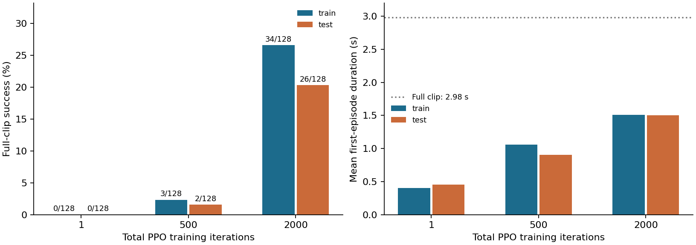
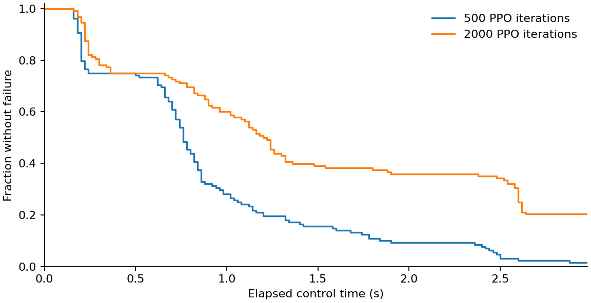
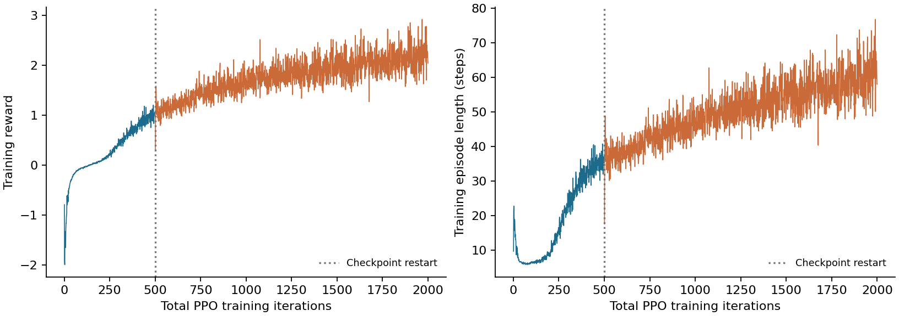

# PhyGile 续训与生成核心复现实验报告

日期：2026-10-17。范围：**公开跟踪器的累计 2000 轮 PPO 训练，以及依据论文自行实现、尚未用真实动作训练的生成模块核心**。完整 PhyGile 仍未复现完成；本次没有 G1 真机实验。

计数更正：跟踪实验旧字段 `optimizer_updates` / `updates` 与附件名中的 updates 实际指 PPO 训练轮次，每轮包含 5 个 epoch × 4 个 minibatch，即 20 次 Adam 步进。500→2000 轮新增 30,000 次 Adam 步进；逐参数计数已由检查点验证。冻结计划、原始收据及旧报告不改写，详见 [计数与参考来源更正](../docs/accounting_terms_erratum.md)。生成入口人工测试的两次 optimizer step 则确为两次 AdamW 步进。

## 1. 已完成什么

在原双 RTX A6000 服务器上，从已归档的 500 轮 PPO 训练模型继续训练 1500 轮 PPO，并完成固定最终检查点的 8 组仿真评估。训练、评估、原始状态重算均退出成功。累计采样量为 49,152,000 个环境转移，其中本轮新增 36,864,000 个；独立冒烟验证不计入这个数字。

环境沿用 Isaac Sim 4.5.0、Isaac Lab 2.1.0、Python 3.10.15、PyTorch 2.5.1+cu118、RSL-RL 2.3.1；使用 GPU 0 和 4 个 CPU 计算线程。本轮续训耗时 59.99 分钟（训练命令收据计时，含启动和保存）。没有更改共享安装或停止服务器其他任务。

2000 轮 PPO 训练模型在测试片段上完成 **26/128 个完整回合（20.31%）**，平均持续 **1.501 秒**。对应 500 轮 PPO 训练为 2/128（1.56%）和 0.904 秒；成功率变化为 +18.75 个百分点。这只描述当前固定数据和预算下的观测，不能外推为完整论文方法的性能。

测试宏平均世界坐标 MPJPE 从 0.1761 米变为 0.2751 米。两轮的终止时刻不同，误差统计覆盖的时段也不同；不能据此声称跟踪精度改善。最终仍有两个测试片段的完整成功为 0/32。该预算下的策略尚不足以作为可靠的通用跟踪基线。

依据论文另行编写的生成核心通过 12 项 CPU 数值检查，另完成真实预训练 DistilBERT 与完整网络的接口检查，并用人工张量验证训练入口的两次更新与保存/加载。**没有用真实动作数据训练生成器、没有文本动作生成质量实验，也没有 physics-prefix 闭环实验。** 这些检查不构成生成能力验证。

## 2. 续训如何保证可追溯

- 父检查点为 500 轮 PPO 训练、seed 42，SHA-256：`afad21ce7192dc4ec10e04fd2bc7684e9278f901dbffcb053cf45b8b04bda162`。
- 恢复后逐张量核对策略、优化器及观测归一化状态，下一次更新索引设为 500；最终索引 1999，累计 2000 轮 PPO 训练。
- 将算法自适应学习率标量与恢复的优化器学习率同步，值为 `1.5e-05`。这修正续训状态恢复，不改 PPO 更新公式。
- 仿真、随机数、采样器和 rollout 状态重新初始化，所以是检查点续训，不能声称与不中断的 2000 次训练逐比特等价。
- 训练仍为 1024 并行环境、每次 24 步、seed 42、20 个动作、单激活专家。奖励、观测、网络和动作数据保持一致。课程仍关闭。
- 500 轮 PPO 训练实验已看过测试集，因此本次是**探索性续训比较**。本轮预先固定总预算 2000，不按测试成绩选择检查点。

本次任务为 `Tracking-Flat-G1-Wo-State-Estimation-v0`。使用公开配置中的专家网络 `[512,256]`，与论文附录 `[2048,1024,512]` 不同。公开加载器未应用 YAML 的 `rewards` 段，实际 global anchor position 奖励权重/std 为 0.5/0.25，而不是 YAML 写出的 0.8/0.2；续训保持这一已核实行为，未中途调奖励。实际参数保存在 [env.yaml](../results/continuation_2000/effective_configuration/env.yaml) 和 [agent.yaml](../results/continuation_2000/effective_configuration/agent.yaml)。

复跑入口见 [续训说明](../docs/continuation_2000.md)。恢复验证见 [独立文档执行记录](../results/continuation_2000/document_witness/report.md)。最终权重 SHA-256：`bb067f364de74e2da7cf1879e6f26bb961a71eb9ff64cbfbe84dd858bfae2336`。

## 3. 数据、指标与限制

沿用上一轮 KungfuAthleteBot 来源动作经过重建、GMR 重定向和 G1 前向运动学得到的运动学参考。训练为 20 片段、7 来源组、59.60 秒；测试为 4 片段、1 来源组、11.92 秒；来源组不交叉。它是独立于被评估策略的外部重建/重定向代理参考，上游处理可能使用模型；不是被评估策略自身的输出，也不是测得的机器人真值轨迹。此实验属于 simulation_only。

每个检查点评估训练片段 000/008/010/014 和全部 4 个测试片段，每片段 32 个并行首回合；评估种子 2026。一个片段为 149 个控制步、50 Hz、2.98 秒。完整成功要求执行全部控制步且未触发失败。这个定义只使用配置中的失败判定，不等价于全程达到指定世界坐标 MPJPE 阈值。

表中的 1 轮训练检查点已经经过一轮 PPO 训练，不是纯随机未训练策略。

MPJPE 为 14 个跟踪刚体的世界坐标位置误差；MPJAE/MPJVE 为 29 个关节的角度/速度绝对误差。状态在物理步后、重置前记录。误差只统计到首次终止，因此更早失败反而可能得到更小误差，不能单看 MPJPE 判断改进。汇总对片段等权平均。所有误差保持物理单位，没有按模型自身输出归一化。

仅 1 个训练种子，32 个回合不是 32 个独立训练种子；测试只有 1 个独立来源组。本文不作显著性或广泛泛化结论。这里的指标也不能与论文不同坐标系、不同数据及阈值的表格直接比较。

## 4. 实际结果

|累计 PPO 轮次|集合|成功/总回合|成功率|平均持续时间（秒）|宏平均 MPJPE（米，终止前）|
|---:|---|---:|---:|---:|---:|
|1|训练内4片段|0/128|0.00%|0.407|0.1484|
|1|测试4片段（1来源组）|0/128|0.00%|0.458|0.1590|
|500|训练内4片段|3/128|2.34%|1.058|0.1970|
|500|测试4片段（1来源组）|2/128|1.56%|0.904|0.1761|
|2000|训练内4片段|34/128|26.56%|1.507|0.2104|
|2000|测试4片段（1来源组）|26/128|20.31%|1.501|0.2751|

下面的测试存活曲线始终以全部 128 个首回合为分母，失败后保持失败，避免只画尚未失败的样本。最后一个点与完整片段成功率一致。

训练奖励与训练内回合长度如下。500 轮 PPO 训练处是恢复检查点的位置；训练日志奖励和存活信号不是独立测试成功率。

2000 轮 PPO 训练逐片段结果：

|集合/片段|成功/回合|持续时间（秒）|MPJPE（米）|MPJAE（弧度）|MPJVE（弧度/秒）|
|---|---:|---:|---:|---:|---:|
|train/000|0/32|0.543|0.1833|0.3282|1.9027|
|train/008|0/32|1.246|0.2858|0.1308|0.8340|
|train/010|19/32|2.264|0.2406|0.1203|0.4928|
|train/014|15/32|1.977|0.1321|0.1536|0.3702|
|test/000|4/32|2.259|0.3606|0.1460|0.7103|
|test/001|0/32|0.344|0.1672|0.1888|1.3353|
|test/002|22/32|2.485|0.3737|0.1382|0.5427|
|test/003|0/32|0.917|0.1989|0.2377|0.9119|

## 5. 自行实现的生成核心

代码在 [reimplementation](../reimplementation/README.md)，与固定版本作者代码 `upstream/` 分开。按论文 v3 的可见规格实现 262D 特征分块、8 层/512 宽/4 头的 decoder、12 专家的参数空间混合 TP-MoE、文本引导掩码和负载均衡、x0 扩散目标、CFG 与前后缀采样约束。完整结构构造得到 146,169,702 个参数；这是本实现的参数数目，不是作者公布的模型参数核验。

数值测试检查参数混合与公式、有效掩码、每个专家及门控张量的梯度、CFG、逐步已知边界注入、归一化、ASFO 权重及完整尺寸网络前向传播。使用的是人工数值张量，不使用虚构文本嵌入冒充真实数据训练。确切测试范围见 [检查记录](../results/reimplementation_core/verification.json) 和 [独立审查](../results/reimplementation_core/audit/EXPERIMENT_AUDIT.md)。

另用真实公开 DistilBERT 权重检查冻结状态、重复编码、批内 padding，以及真实文本 token 接入完整尺寸未训练网络；[接口记录](../results/reimplementation_text/verification.json) 已保存。所选模型 revision 为 `12040accade4e8a0f71eabdb258fecc2e7e948be`，属于本实现明确选择，论文未给出精确 checkpoint 名称。服务器直连 Hugging Face 失败后，经本机下载并核对发布方哈希，再传入服务器逐文件复核；原失败记录与恢复后的成功记录均保留。此过程不涉及动作生成器训练。

训练入口已提供，包含数据哈希、划分检查、训练集归一化、真实文本编码、x0 目标和检查点保存。它仅用显式标为 `unit_test` 的人工数组和缩小网络执行过两次 CPU 更新，验证保存/加载等工程行为；[测试记录](../results/reimplementation_training_witness/verification.json) 不属于动作生成训练结果。示例优化器、噪声 schedule、预算属于待采用的本实现选择，不是作者超参数。

论文没有完整指定或公开的实现选择，包括 AdaLN 具体拓扑、位置编码、summary token 使用、注意力/偏置/空文本掩码和采样器细节，均在代码说明中标记为本实现假设；beta schedule 必须由调用者明确传入。ASFO 已提供权重和显式重复计数策略，尚不含镜像和标签交换。尚缺作者一致的特征编解码、语义关节映射、成对文本动作数据、作者训练设置、生成质量评估和闭环适配。用户已确认目前暂无配套 HumanML3D/G1/SMPL 材料，因此没有用现有少量武术片段代替完整生成训练。

骨架编号尤其不能直接照抄：论文 12 个 body 索引与现有 Isaac Lab 数据顺序不一致，当前资产也没有独立 palm 名称。现有模块仅打包显式提供的语义块，不将错误索引拼成所谓作者 262D 真值。

## 6. 对博士论文 baseline 的意义

当前交付可用作跟踪代码的开发与诊断起点。正式对比时应标明 **“PhyGile released GMT code / adapted tracking setting”**，并说明单激活专家和自有数据。不能标成完整 PhyGile 的主表复现结果，更不能以未训练的生成核心作语言动作生成对比。

要支持完整论文对比，仍需取得或重建配对动作/文本数据与特征语义约定、训练生成器、验证两阶段 GMT 和 physics-prefix 闭环，并在目标动作任务上增加来源组与独立训练种子。当前 20 个武术训练片段不能证明舞蹈、快速转身或跳跃落地的表现。公开课程分支的已知问题也需在启用前修复验证，详见 [上一轮审查](../results/integrity_audit/EXPERIMENT_AUDIT.md)。

## 7. 文件、审查与复查

- [固定预算与评估计划](../configs/continuation_2000_plan.json)
- [流水线退出状态](../results/continuation_2000/pipeline.json)
- [恢复证据](../results/continuation_2000/resume_provenance.json)
- [独立状态与 Adam 步数核对](../results/continuation_2000/state_comparison.json)及[执行收据](../results/continuation_2000/state_comparison_check/receipt.json)
- [逐片段结果 CSV](../results/continuation_2000/evaluation_summary.csv)
- [本轮实验审查](../results/continuation_2000/audit/EXPERIMENT_AUDIT.md)
- [上轮 500 轮 PPO 训练报告](PhyGile复现实验报告.md)
- [本轮检查点和完整原始状态附件](https://github.com/Pendragon08/conditional-human-motion-generation/releases/tag/phygile-tracking-2000updates-20261017)

独立审查采用新的同模型家族代理，结论属于 provisional；确定性原始数据重算和文件哈希可以复查，不等同于外部研究团队复现。Git 保存较小日志与表格，完整 `raw_pre_reset.npz` 和检查点保存在实验附件及本地交付目录。

来源：[官方项目](https://baojch.github.io/phygile-page/)、[固定官方代码](https://github.com/Baojch/phygile_tracking/tree/d48621620f522f5c901ef378d57db8df92d2888d)、[论文 v3](https://arxiv.org/abs/2603.19305v3)。
